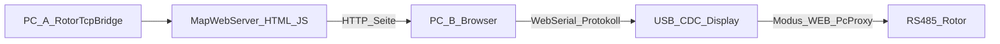

# Web Serial: Controller über Browser anbinden

## Zielbild

- **PC A:** Software wie bisher, inkl. bestehendem [`map_webserver.py`](rotortcpbridge/map_webserver.py) (liefert Seite, Auth, optional Karte/Geocode/Profile).
- **PC B (oder derselbe):** Browser öffnet die Webseite und wählt lokal den USB-COM-Port des Controllers (Chrome/Edge, **Web Serial API**).
- Die Seite spricht dasselbe Framing: `#SRC:DST:CMD:PARAMS:CS$` ([`RotorController_RS485.md`](D:/Rotor/Rotor_Display_5/Info/RotorController_RS485.md), [`rs485_protocol.py`](rotortcpbridge/rs485_protocol.py)).

Das ist **Browser ↔ Controller direkt** (wie ESP-Webtools). Der Server hostet UI/Assets.

## Display-Tasten (neu, Nutzerwunsch)

Heute in [`rotor_app.cpp`](D:/Rotor/Rotor_Display_5/src/rotor_app.cpp) / UI [`screens.c`](D:/Rotor/Rotor_Display_5/src/ui/screens.c): zwei Tasten **Slow** und **Fast** (`objects.slow` / `objects.fast`).

**Umbau:**

| Taste (Platz) | Neu | Verhalten |
|---------------|-----|-----------|
| Bisher Slow **oder** Fast (eine der beiden) | **Modus** | Tippen zyklisch: `RS485` → `PC-USB` → `WEB` → `RS485` … Label zeigt aktuellen Modus |
| Die andere Taste | **Fast/Slow** | Tippen toggelt zwischen Fast und Slow (PWM-Limit wie bisher); Label zeigt `Fast` bzw. `Slow` |

Konkret (festgelegt):

- **Linke Taste** (`slow`-Objekt): Modus-Zyklus, Label z. B. `RS485` / `PC-USB` / `WEB`
- **Rechte Taste** (`fast`-Objekt): Fast/Slow-Toggle, Label `Fast` oder `Slow`, Highlight wie bisher (grün aktiv)

### Bedeutungen der drei Link-Modi

| Modus | Persistenz | Bus / USB |
|-------|------------|-----------|
| **RS485** | `link_mode=0` ≈ `remote_usb=0` | Display ist normaler RS485-Master (`LocalMaster`). USB nur Sniffer/Brücke, kein dedizierter Web-Host. |
| **PC-USB** | `link_mode=1` ≈ `remote_usb=1` / `SETCONREMOTE:1` | RS485-TX stumm; Desktop-[`controller_remote_usb.py`](rotortcpbridge/controller_remote_usb.py) proxyt USB↔Rotor-Bus. |
| **WEB** | `link_mode=2` (neu) | RS485-Brücke aktiv (`remote_usb=0`); USB-Host ist der **Browser** (Web Serial). Bei USB-Frames → `PcProxyMaster` wie heute. Desktop soll denselben COM nicht öffnen. |

Persistenz in Display-`config.json` (neben bestehendem `remote_usb`): neues Feld `link_mode` (0/1/2). Beim Setzen von PC-USB weiter `remote_usb=1` und `serial_bridge::set_remote_usb(true)`; bei RS485/WEB `remote_usb=0`. `SETCONREMOTE`/`GETCONREMOTE` bleiben kompatibel; optional `GETLINKMODE`/`SETLINKMODE` für Web-UI und klare Drei-Wege-Anzeige.

## Secure Context (Pflicht)

Web Serial nur unter **HTTPS** oder `localhost`. Map-Webserver: optionales TLS + UI-Hinweis.

## Umsetzung Firmware (`Rotor_Display_5`) — zuerst Display-Bedienung

1. **Tasten-Logik** in [`rotor_app.cpp`](D:/Rotor/Rotor_Display_5/src/rotor_app.cpp): `on_slow_btn` → Modus-Zyklus; `on_fast_btn` → Fast/Slow-Toggle (bisherige PWM-Logik beider Tasten zusammenführen).
2. **Labels/Styles** anpassen (`label__slow` = Modusname, `label_fast` = Fast/Slow); Modus-Taste farblich vom PWM-Toggle unterscheidbar halten.
3. **`pwm_config`**: `link_mode` laden/speichern; Sync mit `remote_usb` / `set_remote_usb`.
4. **Protokoll**: `GETLINKMODE` / `SETLINKMODE` (oder erweiterte ACK von `GETCONREMOTE`); Doku in `Info/RotorController_RS485.md`.
5. **PcProxy-/Idle-Timeout** im Modus WEB bei Bedarf nach erstem Browser-Test lockern.

Kein WiFi-Webserver auf dem ESP — Seite bleibt bei RotorTcpBridge.

## Umsetzung RotorTcpBridge (Web)

1. **JS Web Serial**: Port öffnen 115200, Frame-Splitter, Checksum wie [`rs485_protocol.py`](rotortcpbridge/rs485_protocol.py), kein DTR/RTS-Reset.
2. **Web-Kompass-UI**: „Controller verbinden (USB)“; Status inkl. Display-`link_mode`; Live Ist/Soll/Stop/Set über Serial im Modus WEB.
3. **Koexistenz**: Server-SSE vs. lokales Web Serial; Desktop-`controller_link` nicht parallel auf denselben COM.
4. **TLS** am Map-Webserver; Locales DE/EN.

## Bewusst nicht im ersten Schritt

- Serial-Tunnel Server ↔ Browser (anderes Modell)
- Headless ohne Desktop-Prozess
- Gleichzeitiger Desktop-`controller_link` + Browser auf demselben COM

## Reihenfolge

1. Display-Tasten umbauen (Modus-Zyklus + Fast/Slow-Toggle) inkl. `link_mode`-Persistenz
2. Protokoll GET/SET Link-Mode + Doku
3. TLS am Map-Webserver
4. Web-Serial-Transport + Connect-UI
5. Kompass-Live aus Web Serial (primär bei Display-Modus WEB)
6. Timeout-Feinschliff nach Test; Locales/Hinweise
